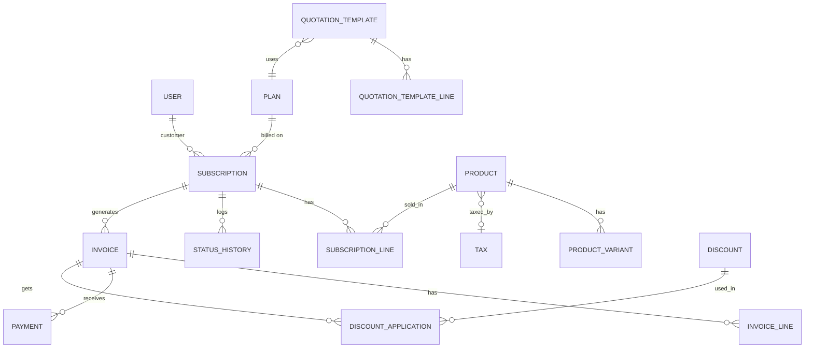

# Brightloop Subscription Management System

One platform to run the full life of a subscription business: products and plans, quotations, subscriptions, automatic invoicing, payments and a finance dashboard.

Built for **HACKINAUTS-ODOO** by Suraj, Tom and Adhithyan.

## The problem

Brightloop Software sells software on monthly and yearly subscriptions, but runs the business on spreadsheets: renewals get missed, invoices are typed by hand, payments are matched by scrolling bank statements, and nobody knows the real recurring revenue. This system replaces all of that.

## Features

**Admin** (full control)
- Create staff accounts (only the admin can)
- Products with variants (for example, brand Odoo adds 560 to the price), sales and cost price
- Billing plans: daily, weekly, monthly or yearly, minimum quantity, availability dates, and per-plan rules for auto-close, early close, pause and renewal
- Tax rules and discount rules (fixed or percentage, minimums, dates, usage limits)
- Quotation templates, automated billing, finance summary dashboard

**Staff** (limited day-to-day access)
- Prepare quotations from templates and track subscription statuses
- Confirm, cancel, send and print invoices
- Record payments and monitor overdue accounts
- View revenue and payment filters

**Customer** (portal)
- Create an account and reset a forgotten password by email
- View and manage only their own subscriptions and invoices
- Request bulk seat discounts
- No access to internal data, company revenue or catalog pricing

## Tech stack

| Layer | Choice |
| --- | --- |
| Backend | Python, Django |
| Database | PostgreSQL (via Docker Compose) |
| Frontend | Django templates, Bootstrap 5, Chart.js |
| Email | Django console email backend (reset links print in the terminal) |
| Billing job | Django management command |

PostgreSQL was chosen because the domain is relational and needs constraints, transactions and indexes. No Firebase, Supabase or MongoDB Atlas is used.

## Project structure

```
config/          project settings and URLs
accounts/        custom user with role, signup, login, password reset, staff management
catalog/         products, variants, plans, taxes, discounts
subscriptions/   quotation templates, subscriptions, status history
billing/         invoices, payments, billing service and commands
portal/          customer-facing pages
reports/         finance dashboard
core/            shared helpers and the seed command
templates/       HTML templates, one folder per app
static/          CSS
```

## Setup

Requirements: Python 3.11+ and Docker (or a local PostgreSQL).

```bash
git clone https://github.com/surajkrishnak/HACKINAUTS-ODOO.git
cd HACKINAUTS-ODOO

python -m venv venv
source venv/bin/activate        # Windows: venv\Scripts\activate
pip install -r requirements.txt

cp .env.example .env            # then edit SECRET_KEY and DB values if needed
docker compose up -d            # starts PostgreSQL

python manage.py makemigrations accounts catalog subscriptions billing
python manage.py migrate
python manage.py seed
python manage.py runserver
```

Open http://127.0.0.1:8000.

If you do not use Docker, install PostgreSQL locally and set `DB_NAME`, `DB_USER`, `DB_PASSWORD`, `DB_HOST` and `DB_PORT` in `.env`.

### Environment variables

| Variable | Purpose |
| --- | --- |
| `SECRET_KEY` | Django signing key. Use a long random string and never commit `.env`. |
| `DEBUG` | `True` for development, `False` for production |
| `DB_NAME`, `DB_USER`, `DB_PASSWORD`, `DB_HOST`, `DB_PORT` | PostgreSQL connection |

Generate a key with:

```bash
python -c "from django.core.management.utils import get_random_secret_key as k; print(k())"
```

## Demo accounts

All demo passwords are `Password@123`.

| Role | Email |
| --- | --- |
| Admin | admin@brightloop.test |
| Staff | staff@brightloop.test |
| Customer | any customer created by `seed`, or sign up with your own email |

## Useful commands

```bash
python manage.py seed                       # demo data
python manage.py seed --bulk 5000           # plus 5,000 subscriptions to test performance
python manage.py generate_invoices          # billing day: invoice every due subscription
python manage.py generate_invoices --dry-run
python manage.py generate_invoices --date 2026-11-01   # simulate a billing day
python manage.py close_expired_subscriptions
python manage.py close_expired_plans
python manage.py test                       # run the test suite
```

Running `generate_invoices` twice in a row creates nothing the second time.

## Status flows

**Subscription:** Draft → Quotation → Confirmed → Active → Closed

**Invoice:** Draft → Confirmed → Paid (an invoice can be cancelled before any payment is recorded)

## Role permissions

| Capability | Admin | Staff | Customer |
| --- | :---: | :---: | :---: |
| Add staff members | Yes | No | No |
| Create products and variants | Yes | No | No |
| Set billing plans and renewal behavior | Yes | No | No |
| Configure taxes | Yes | No | No |
| Create discount rules and limits | Yes | No | No |
| Finance summary dashboard | Yes | No | No |
| Prepare quotes from templates | Yes | Yes | No |
| Track subscription statuses | Yes | Yes | Own only |
| Confirm, cancel, send, print invoices | Yes | Yes | No |
| Record payments, monitor overdue | Yes | Yes | No |
| View revenue and payment filters | Yes | Yes | No |
| View own subscriptions and invoices | n/a | n/a | Yes |
| Request bulk seat discounts | n/a | n/a | Yes |
| Access internal data or company revenue | Yes | Yes | No |

Permissions are enforced on the server for every route, and customers only ever query their own records.

## Database design



### Key design decisions

- **Money is exact.** All amounts use `DecimalField(12, 2)`, never floats.
- **Price snapshots.** Unit price and tax rate are copied onto subscription and invoice lines, so old invoices never change when the catalog does.
- **No double billing.** A unique constraint on invoice (subscription, period start, period end) plus an idempotent billing command that also catches up on missed periods.
- **Safe discount limits.** Discount rows are locked with `select_for_update()` inside a transaction, so concurrent runs cannot exceed the usage limit.
- **Business logic in services.** Invoice generation, status transitions and discounts live in `services.py`, so the UI and the billing command share the same code.
- **Speed.** Indexes on status, due date, customer and date columns, aggregate queries for the dashboard, pagination on every list, and `select_related` to avoid N+1 queries. The goal is every page under 2 seconds with thousands of subscriptions.
- **Security.** Server-side role checks, per-customer data isolation, CSRF protection, hashed passwords, expiring single-use reset links, login lockout after repeated failures, and ORM-only queries.

## Password rules

More than eight characters, with at least one uppercase letter, one lowercase letter and one special character. Each email can belong to only one account.

## Demo walkthrough: one billing month

1. A customer signs up and (optionally) resets their password.
2. The admin creates a product with variants, a plan, a tax and a discount rule.
3. Staff create a quotation from a template, then move the subscription Draft → Quotation → Confirmed → Active.
4. On billing day, run `python manage.py generate_invoices`. Invoices appear with taxes and discounts already applied.
5. Staff confirm and send an invoice, then record a payment against it.
6. The finance dashboard shows active subscriptions, MRR, revenue collected, outstanding amounts and overdue invoices.

## Team

| Name | Area |
| --- | --- |
| Suraj | Project setup, accounts, catalog |
| Tom | Subscriptions, billing |
| Adhithyan | Customer portal, finance dashboard, documentation |
